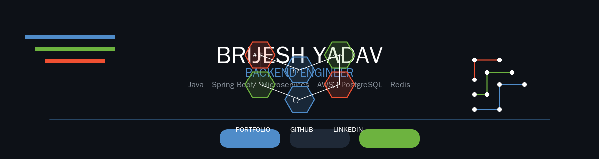

<!-- Header Section with Professional Banner -->

  
  
  # Brijesh Yadav | Backend Engineer
  
  

    
    
    
    
    
  

  
  

<!-- About Me Section -->
## 👨‍💻 About Me

I'm a passionate backend engineer with **5+ years** of experience building robust, scalable services. I specialize in transforming complex business requirements into production-grade microservices and clean, efficient APIs.

- 🔭 **Currently Building:** **Growth Quantix** - Real-time trading & analytics platform
- 🌱 **Learning:** Advanced distributed systems, Kubernetes, system design patterns
- 💡 **Interests:** Event-driven architecture, low-latency systems, database optimization
- 🎯 **Focus:** Backend development, microservices, cloud infrastructure
- 🌍 **Location:** Mysore, India
- 📫 **Reach me:** `brijeshyadav30599@gmail.com`
- 👨‍💻 **Open Source:** Author of [`upstox-auth-pro`](https://pypi.org/project/upstox-auth-pro/) (Python SDK on PyPI) and [`codive`](https://github.com/recscse/codive) (MCP server for AI coding agents)
- 📚 **Mentoring:** Helped 10+ junior developers grow their skills

<!-- Tech Stack Section -->
## 🛠️ Tech Stack

<b>Programming Languages</b>

 

  
  
  
  
  

<b>Frameworks & Libraries</b>

 

  
  
  
  
  
  

<b>Databases & Caching</b>

 

  
  
  
  
  

<b>Cloud & DevOps</b>

 

  
  
  
  
  
  
  
  
  

<b>Tools & IDEs</b>

 

  
  
  
  
  

<!-- Experience Section -->
## 💼 Professional Experience

  

    
    <h3>Software Engineer</h3>
    
<i>Oct 2021 – Present | Mysore, India</i>

    <ul>
      <li>🏗️ <b>Developed and maintained Spring Boot microservices</b> supporting critical pharmacovigilance workflows used by global pharmaceutical organizations</li>
      <li>🔌 <b>Designed and implemented REST APIs</b> and backend services enabling enterprise integrations and workflow automation</li>
      <li>📧 <b>Built high-volume email ingestion and document-processing pipelines</b> handling thousands of inbound emails and attachments</li>
      <li>🧠 <b>Integrated OCR and NLP-based pipelines</b> that turn unstructured business data into structured records, improving processing efficiency by approximately 80% with extraction accuracy above 95%</li>
      <li>🔄 <b>Optimized PostgreSQL and MySQL queries</b>, improving application performance and scalability</li>
      <li>🛠️ <b>Investigated production issues</b>, performed root-cause analysis and delivered reliable fixes in Agile teams</li>
    </ul>
  

  
  

    
    <h3>Backend Developer (Freelance)</h3>
    
<i>Jun 2020 – Sep 2021 | Remote</i>

    <ul>
      <li>🌐 <b>Developed RESTful APIs</b> for various clients using Spring Boot and Node.js</li>
      <li>🔒 <b>Implemented authentication systems</b> with OAuth2 and JWT for secure API access</li>
      <li>🛢️ <b>Designed database schemas</b> for optimal performance and data integrity</li>
      <li>📱 <b>Created backend services</b> for mobile applications with real-time data synchronization</li>
    </ul>
  

<!-- Projects Section -->
## 🎯 Featured Projects

<table>
  <tr>
    <td width="50%" valign="top">
      <h3 align="center">📈 Growth Quantix</h3>
      

        
        
      

      
<strong>Python, FastAPI, PostgreSQL, Redis, WebSockets, React</strong> - multi-broker algorithmic trading platform (Upstox, Dhan, Fyers)

      <ul>
        <li>✅ Real-time market-data ingestion with WebSocket streaming to dashboards</li>
        <li>✅ Paper trading, backtesting, portfolio and broker-account management</li>
        <li>✅ Modular services: market data, broker integrations, execution, users</li>
      </ul>
    </td>
    <td width="50%" valign="top">
      <h3 align="center">🔐 Upstox Auth Pro</h3>
      

        
        
        
      

      
<strong>Python, Playwright, OAuth2, TOTP, GitHub Actions</strong> - open-source SDK (Python on PyPI, plus a Java version) that automates Upstox authentication

      <ul>
        <li>✅ Browser-automated login with TOTP 2FA and secure token generation</li>
        <li>✅ Pluggable token storage, automatic refresh, retries and diagnostics</li>
        <li>✅ CLI tool and automated release workflow</li>
      </ul>
    </td>
  </tr>
  <tr>
    <td width="50%" valign="top">
      <h3 align="center">🧠 codive</h3>
      

        
        
      

      
<strong>Go, SQLite, MCP</strong> - local-first code-intelligence server that gives AI coding agents symbols, call graphs and file outlines instead of whole files

      <ul>
        <li>✅ Measured 92.4% smaller output across five operations in its own benchmark (one repo, tokens estimated; plain <code>git grep</code> wins on simple lookups) - <a href="https://github.com/recscse/codive/blob/main/docs/BENCHMARK_REPORT.md">report</a></li>
      </ul>
    </td>
    <td width="50%" valign="top">
      <h3 align="center">📄 Prindox</h3>
      

        
      

      
<strong>Python, FastAPI, PostgreSQL</strong> - online document printing platform

      <ul>
        <li>✅ Document upload, print-order management and workflow automation APIs</li>
        <li>✅ Asynchronous background processing for validation and orders</li>
      </ul>
    </td>
  </tr>
</table>

<!-- GitHub Stats Section -->
## 📊 GitHub Stats & Activity

  
  

  

<!-- Contribution & Productivity Stats -->
## 📈 Contribution & Productivity

  
  
  ### ⚡ Coding Metrics (Last 30 Days)
  
  
  
  
  ### 🏆 GitHub Trophies
  

<!-- Latest Blog Posts -->
## ✍️ Engineering Blog

Write-ups from [my portfolio blog](https://recscse.github.io/portfolio/blog/index.html):

- [The Math of Winning: Kelly Criterion Risk Engine](https://recscse.github.io/portfolio/blog/kelly-criterion-risk-engine.html)
- [Designing a Real-Time Market Data Pipeline for an Algorithmic Trading Platform](https://recscse.github.io/portfolio/blog/designing-real-time-market-data-pipeline-algorithmic-trading.html)
- [Building a Production-Ready OAuth2 Automation SDK for Upstox](https://recscse.github.io/portfolio/blog/building-production-ready-oauth2-automation-sdk-upstox.html)
- [QR-based Document Handoffs with Audit Trails](https://recscse.github.io/portfolio/blog/qr-document-handoffs.html)
- [Spring Boot Email Pipeline: From Queue to Delivery](https://recscse.github.io/portfolio/blog/spring-boot-email-pipeline.html)

## 📚 Skills & Certifications

  
<b>Summer Internship</b> - Data Driven Computing and Networking, MNNIT Allahabad

  <h3>Core Skills</h3>
  <table>
    <tr>
      <td align="center"><b>System Design</b></td>
      <td align="center">
        
      </td>
      <td align="center"><b>API Development</b></td>
      <td align="center">
        
      </td>
    </tr>
    <tr>
      <td align="center"><b>Database Optimization</b></td>
      <td align="center">
        
      </td>
      <td align="center"><b>Microservices</b></td>
      <td align="center">
        
      </td>
    </tr>
    <tr>
      <td align="center"><b>Cloud Infrastructure</b></td>
      <td align="center">
        
      </td>
      <td align="center"><b>DevOps Practices</b></td>
      <td align="center">
        
      </td>
    </tr>
  </table>

<!-- Education Section -->
## 🎓 Education

  
  
<b>Rajkiya Engineering College Sonbhadra</b>

  
B.Tech, Computer Science & Engineering | 2017 - 2020 | CGPA: 7.5/10

  
  <h4>Relevant Coursework</h4>
  
Data Structures & Algorithms, Operating Systems, Database Management Systems, Computer Networks, Software Engineering, Distributed Computing

<!-- Let's Connect Section -->
## 📫 Let's Connect

  
  
  
  
  
  
  
  <h3>💬 Open to opportunities and collaborations</h3>
  
Whether you have a question, a project idea, or just want to connect, feel free to reach out!

<!-- Footer -->

  
  
  <b>🚀 "Building the backend that powers tomorrow's applications"</b>
  
  ⭐ **From [recscse](https://github.com/recscse)**

